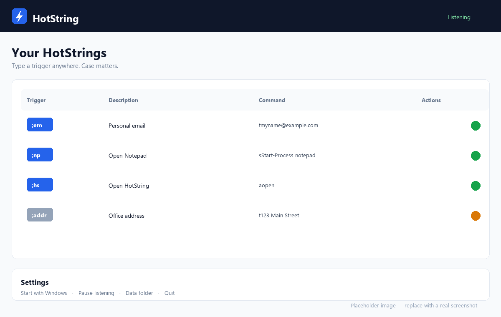
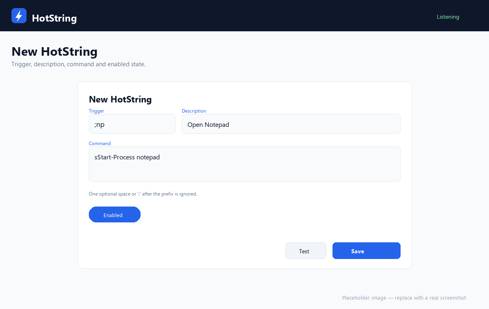
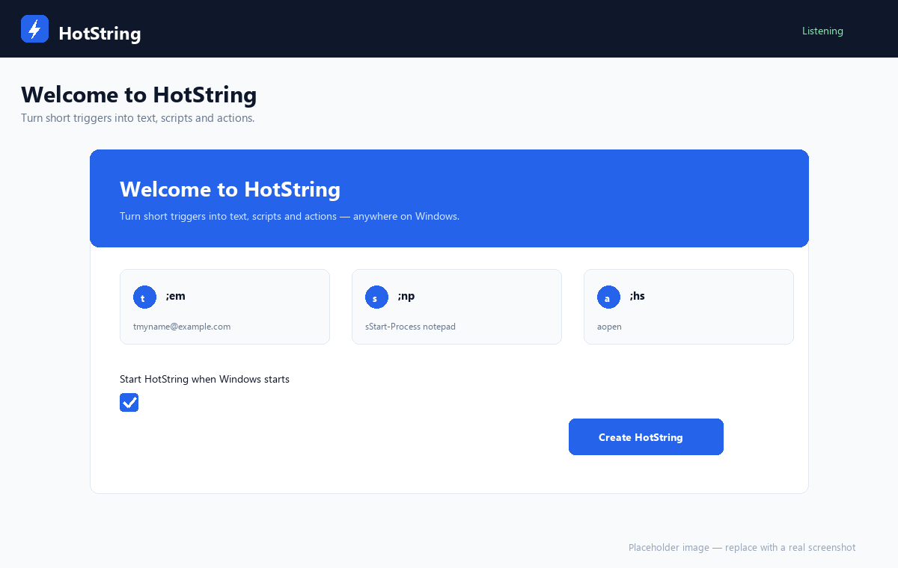

# HotString

[](https://github.com/jeeradate/hotstring2/actions/workflows/ci.yml)
[](LICENSE)
[](pyproject.toml)

**Type less. Do more.**

HotString is a Windows desktop utility that turns short, case-sensitive triggers into text, PowerShell scripts, or built-in application actions. Every trigger starts with **`;`**. Type a trigger in **any** application and HotString erases it, then performs the configured command.

It runs quietly in the system tray, supports Thai and other Unicode text, and includes a native desktop management window built with NiceGUI and pywebview.

- **Text expansion** — `;em` → `tmyname@example.com`
- **PowerShell launcher** — `;np` → `sStart-Process notepad`
- **App actions** — `;hs` → `aopen` (reopen HotString from anywhere)
- **Prefix suggestions** — type `;e` to pop up a list of matching HotStrings, then press Enter to run one
- **Native window + tray icon** — no browser tab, no always-visible window
- **Local-first** — SQLite database under `%APPDATA%\HotString`, no account or cloud service

---

## Screenshots

> The images below are placeholders checked into `docs/screenshots/`. Replace them with real captures before publishing a release.

| Dashboard | Editor |
| --- | --- |
|  |  |

| First-run onboarding |
| --- |
|  |

---

## Requirements

- **Windows 10 or Windows 11** (the target platform; development imports may work elsewhere, but the keyboard hook and autostart are Windows-specific)
- **Python 3.11 or newer** with Tkinter (included in standard Windows Python builds; used by the suggestion popup)
- **[uv](https://docs.astral.sh/uv/)** for installation and running
- **Microsoft Edge WebView2 Runtime** for the native window (preinstalled on current Windows 10/11 systems; [download it here](https://developer.microsoft.com/microsoft-edge/webview2/) if needed)
- **PowerShell** for `s` commands — HotString prefers **PowerShell 7+ (`pwsh`)** when available and falls back to **Windows PowerShell 5.1 (`powershell.exe`)**, which is included with Windows

---

## Install from source

```powershell
git clone https://github.com/jeeradate/hotstring2.git
cd hotstring2
uv sync
uv run hotstring
```

The first launch creates `%APPDATA%\HotString\hotstring.db` and shows the welcome screen. Complete onboarding once, then HotString starts silently in the tray on later launches.

> The repository pins Python 3.11 in `.python-version`. `uv sync` will download that interpreter automatically if it is not already installed.

To run the test suite:

```powershell
uv run pytest
```

---

## First run

HotString considers the database "new" when it has no `aopen` action. On first run it shows an onboarding screen that:

1. Explains the trigger/command format with live examples.
2. Pre-fills `;hs` → `aopen`.
3. Offers **Start HotString when Windows starts**, checked by default.

The `aopen` entry is important: it is the emergency shortcut that brings the management window back when it is hidden. If the database is non-empty but no `aopen` exists, onboarding offers to add one without disturbing your existing entries.

---

## Everyday use

- Type a trigger in Notepad, a browser, Slack, Word, or any other app. HotString removes the trigger and runs the command.
- Type just `;` followed by one non-space character to open the **suggestion popup**. Keep typing to filter, use `↑`/`↓` to change the highlighted row, then press `Enter` (or click a row) to run it.
- **Close** the management window with the window's X button — HotString keeps running in the tray.
- **Reopen** it from the tray icon, or by typing your `aopen` trigger (for example `;hs`).
- **Start a second copy** (`uv run hotstring`) — it signals the running instance to show its window and then exits. Only one database owner runs at a time.
- **Pause** listening from the tray menu or Settings when you do not want triggers to fire.
- **Exit** from the tray menu or the Settings card.

### Tray menu

| Item | What it does |
| --- | --- |
| Open HotString | Shows and focuses the management window |
| Pause listening / Resume listening | Stops or restarts trigger matching without exiting |
| Start with Windows | Toggles the current-user startup registration |
| Exit | Stops the listener, tray, database, and process |

---

## Command format

Every command starts with a **one-character type prefix**. Separately, a trigger is **2–8 characters total**, must begin with **`;`**, and has no whitespace.

| Prefix | Type | Example | Result |
| --- | --- | --- | --- |
| `t` | Text | `tmyname@example.com` | Types the email address |
| `s` | PowerShell | `sStart-Process notepad` | Runs the script with Windows PowerShell |
| `a` | App action | `aopen` | Opens the HotString window |

Because HotString can execute PowerShell commands, it can automate Windows tasks endlessly. You can look up PowerShell commands for various tasks using AI chats like Gemini, ChatGPT, etc., and copy them to test in the command field.

One optional separator directly after the prefix is ignored. These are equivalent:

```text
tHello
t Hello
t:Hello
```

Only the first separator is removed, so `t: Hello` types ` Hello` (with a leading space). After `t`, everything is literal, including additional colons, spaces, and newlines.

### Text commands (`t`)

```text
tHello, world!
tmyname@example.com
tสวัสดีครับ
```

The editor is a textarea, so multi-line text is supported:

```text
tLine one
Line two
Line three
```

How text is delivered:

- Short ASCII text is sent with Unicode `SendInput` keystrokes. It does not touch the clipboard.
- Non-ASCII text (including Thai), multi-line text, tabs, and long text use the clipboard: save the current text → copy the new text → send `Ctrl+V` → restore the previous text after a short delay.
- Set `HOTSTRING_TEXT_MODE=type` or `HOTSTRING_TEXT_MODE=paste` to force one strategy.

### PowerShell commands (`s`)

```text
sStart-Process notepad
sGet-Date | Set-Clipboard
sStart-Process "https://github.com"
```

Scripts run in a background thread with:

```text
<powershell> -NoProfile -WindowStyle Hidden -ExecutionPolicy Bypass -Command <script>
```

`<powershell>` is `pwsh` (PowerShell 7+) when it is found on `PATH`, otherwise `powershell.exe` (Windows PowerShell). The exact executable in use is shown in the app's **Settings**.

No console window is shown. Standard output, standard error, and the exit code are written to the log. Non-zero exit codes and startup failures produce a notification.

Since HotString can run PowerShell scripts, the possibilities for automating Windows are endless. Just ask an AI like Gemini or ChatGPT for a PowerShell command to handle any task, copy it, and test it right inside HotString!

> **Security warning:** `s` commands are arbitrary PowerShell scripts that run with **your user permissions**. There is no sandbox. `-ExecutionPolicy Bypass` is used so scripts work without changing machine policy. Only add scripts you wrote or fully understand, and review any shared database before running it.

### App actions (`a`)

| Action | Description |
| --- | --- |
| `aopen` | Show the HotString management window |
| `apause` | Pause listening |
| `aresume` | Resume listening |
| `atoggle` | Toggle listening on or off |
| `aexit` | Exit HotString |

Unknown actions are rejected when you save the HotString. If the database contains an unknown action (for example after a downgrade), the command is logged and ignored.

### Trigger rules

- **Start with `;`** — this is the only allowed start marker. Typing `;` clears any pending text and starts a fresh trigger sequence; a second `;` inside a trigger is rejected.
- **2–8 characters total** (the `;` counts as one), no spaces, tabs, or control characters.
- **Case-sensitive**: `;em` and `;EM` are different triggers.
- Matching uses the characters your active keyboard layout produces. A Thai layout produces Thai characters; a US layout produces US characters. Switch layouts or use characters available on the layout you type with.
- Matching looks for the **longest** matching suffix when several triggers end at the same position. Since every valid trigger starts with `;`, suffix conflicts are not possible between them.
- Only enabled HotStrings are watched. Changes take effect immediately.
- Legacy rows without `;` are automatically given the prefix on startup. A row is skipped (and reported) if the new trigger would be too long or collide with an existing one; skipped rows stay in the table but never fire until you edit them.

### Prefix suggestion popup

As soon as you type `;` and **one more non-space character** (for example `;e`), HotString shows a small always-on-top popup with the enabled HotStrings whose triggers start with what you typed. It does **not** take keyboard focus, so you can keep typing in the same application.

| Action | Result |
| --- | --- |
| Type more characters | Filters the list down to triggers with that prefix |
| `↑` / `↓` | Moves the highlight |
| `Enter` | Runs the highlighted HotString immediately |
| Click a row | Runs that HotString immediately |
| `Esc`, `space`, navigation keys, mouse click outside, focus change | Closes the popup and clears the pending trigger |
| `Backspace` | Removes the last character and refreshes the list |

When you choose a suggestion, HotString erases only the characters you actually typed (`;e`, for example), then runs the selected command — the same as typing the full trigger. Typing a complete trigger still fires that trigger directly, even if a different row is highlighted. Exact-case matches are listed first, followed by case-insensitive matches so `;E` still finds `;email`. The popup is capped at eight results and only offers enabled entries.

### What resets a pending trigger

The rolling 8-character buffer is cleared by:

- `Enter`, `Esc`, `Tab`, `space`
- Arrow keys, `Home`, `End`, `Page Up`, `Page Down`, `Delete`, `Insert`
- Function keys `F1`–`F12`
- Mouse clicks and scrolling
- Switching the foreground window
- Backspace removes the last buffered character and refreshes the suggestion popup
- Typing `;` starts a new pending trigger and clears earlier characters
- Typing while `Ctrl`, `Alt`, or `Win` is held is ignored

HotString also ignores keystrokes it injects itself, so expansion never re-triggers the listener.

---

## Managing HotStrings

The dashboard table lists every entry with its trigger, description, command, and enabled state.

- **Add** — use either Add button to open the editor.
- **Edit** — the pencil button opens the same editor with the current values.
- **Enable / disable** — the table toggle takes effect immediately; disabled entries stay in the database but are not watched.
- **Delete** — the trash button asks for confirmation first.
- **Search** — the search box filters by trigger, description, or command.
- **Long commands** — the editor keeps its **Save** and **Test** buttons pinned while the form scrolls. The command box stops growing at about a third of the window height and scrolls internally, and the **expand** button in the editor header widens the editor to nearly the full window.
- **Test** — the editor's Test button previews `t` text instead of typing it, runs `s` scripts and shows their output, and validates `a` actions without performing them.
- **Validation** — triggers must be unique, start with `;`, be 2–8 characters total, and contain no whitespace or extra semicolons. The editor warns about suffix conflicts (mostly relevant to legacy rows).

Changes are written to SQLite and the live listener is updated in the same operation, so you do not need to restart HotString after editing.

---

## Settings

### Start with Windows

The toggle writes a single value to the **current user's** Run key:

```text
HKCU\Software\Microsoft\Windows\CurrentVersion\Run
Value name: HotString
Value: "<pythonw.exe>" -m hotstring
```

`pythonw.exe` is used when available, so no console window appears at login. Disabling the toggle removes only the `HotString` value; it does not affect other startup entries. Run `uv run hotstring` once after moving the virtual environment, or toggle the setting off and on, so the stored path is refreshed.

### Pause listening

Pausing keeps the tray icon, window, and database available but stops matching triggers. The state is shown in the header and reflected in the tray menu. Pause does not survive an application restart.

### Data and logs

| Item | Location |
| --- | --- |
| Database | `%APPDATA%\HotString\hotstring.db` |
| Rotating log | `%APPDATA%\HotString\hotstring.log` (1 MB × 3 backups) |
| Override data directory | Set `HOTSTRING_DATA_DIR` before launching |

The Settings card shows the exact paths and has an **Open data folder** button. The database uses SQLite WAL mode and is safe to back up by copying `hotstring.db` (plus the `-wal`/`-shm` files while HotString is running, or after it has exited).

---

## Development

### Project layout

```text
hotstring/
├── src/hotstring/
│   ├── __init__.py          # package version
│   ├── __main__.py          # console-script / python -m entry point
│   ├── app.py               # lifecycle, CLI, single instance, wiring
│   ├── autostart.py         # HKCU Run registry integration
│   ├── config.py            # paths, constants, rotating logging
│   ├── db.py                # SQLModel engine and CRUD
│   ├── executor.py          # command parsing, typing, PowerShell, actions
│   ├── listener.py          # pynput global keyboard/mouse hook
│   ├── matching.py          # pure rolling-buffer matcher (testable)
│   ├── models.py            # SQLModel table + validation
│   ├── native_window.py     # pywebview close-to-hide hook
│   ├── single_instance.py   # named mutex + show-UI event
│   ├── suggestions.py       # always-on-top prefix suggestion popup (Tk thread)
│   ├── tray.py              # pystray icon and menu
│   └── ui.py                # NiceGUI dashboard, onboarding, dialogs
├── tests/
│   ├── test_models.py
│   ├── test_matching.py
│   └── test_executor.py
├── docs/screenshots/        # README placeholders
├── pyproject.toml
├── uv.lock
└── README.md
```

The keyboard hook and UI are deliberately separated from pure logic. `matching.py`, command parsing, validation, and database CRUD can all be tested without installing a keyboard hook or opening a window.

### Useful commands

```powershell
uv sync                 # install dependencies
uv run pytest           # run the test suite
uv run pytest -q        # quiet output
uv run hotstring --help # CLI options
```

### Debug flags

| Flag | Purpose |
| --- | --- |
| `--show` | Show the management window at startup even when not needed |
| `--no-native` | Serve the UI in a browser instead of a native window |
| `--no-tray` | Disable the tray icon (use with `--no-hook` for UI work) |
| `--no-hook` | Disable the global keyboard hook |
| `--port PORT` | Pin the local HTTP port |
| `--log-level LEVEL` | `DEBUG`, `INFO`, `WARNING`, `ERROR`, or `CRITICAL` |
| `--version` | Print the version and exit |

For isolated UI experiments:

```powershell
$env:HOTSTRING_DATA_DIR = "$env:TEMP\hotstring-dev"
uv run hotstring --show --no-tray --no-hook
```

### Environment variables

| Variable | Effect |
| --- | --- |
| `HOTSTRING_DATA_DIR` | Override `%APPDATA%\HotString` for the database, log, and assets lookup |
| `HOTSTRING_LOG_LEVEL` | Default log level before the CLI flag is applied |
| `HOTSTRING_TEXT_MODE` | `auto` (default), `type`, or `paste` |

### Tests

```text
uv run pytest
```

The suite covers trigger validation (including the mandatory `;` prefix), legacy-trigger migration, suggestion lookup, suffix-conflict warnings, database CRUD and first-run detection, rolling-buffer matching, prefix/suggestion flow in the listener, command parsing, text delivery selection, PowerShell argument construction, action dispatch, and asynchronous error reporting. PowerShell, the keyboard hook, and text injection are mocked; the tests never type into your desktop or run a real script.

---

## Troubleshooting

**Nothing happens when I type a trigger**

- Check whether listening is paused (header badge and tray menu).
- The trigger must start with `;`; older entries are prefixed automatically at startup, but skipped ones must be edited manually.
- Triggers are case-sensitive and depend on the active keyboard layout.
- The window must have keyboard focus; HotString cannot see input directed at elevated ("Run as administrator") windows unless HotString itself is elevated.
- Make sure the HotString is enabled and the trigger is not in a suffix conflict with a shorter trigger.
- Check `%APPDATA%\HotString\hotstring.log` for hook errors.

**The suggestion popup does not appear**

- Type `;` followed by one non-space character; `;` alone does not open it.
- Only enabled HotStrings starting with the typed prefix are shown. If none exist, nothing appears.
- The popup appears near the mouse pointer, stays on top, and does not take focus. Press `Esc` or click elsewhere to dismiss it.
- The popup needs Tkinter (included with standard Windows Python distributions). Check the log if it cannot be created.

**The window does not appear**

- Use the tray icon → **Open HotString**, or type your `aopen` trigger.
- If the native window cannot start, HotString logs the error and may show a native error dialog. Install or repair the Edge WebView2 Runtime.
- Try `uv run hotstring --show --no-tray --no-hook --log-level DEBUG` to isolate the issue.

**`s` commands fail**

- Confirm the PowerShell executable shown in **Settings** is available and the script works when run manually in that shell.
- Read the log for stdout, stderr, and the exit code.
- Some cmdlets and behaviors differ between Windows PowerShell 5.1 and PowerShell 7+. If a script requires a specific version, install that version and verify which one HotString selected in **Settings**.

**The clipboard is briefly overwritten**

This is expected for Unicode, multi-line, and long text. HotString restores the previous **text** shortly afterwards. Images and other clipboard formats are not preserved and are replaced by the text.

**Start with Windows does not work after moving the project**

The Run value stores an absolute path to `pythonw.exe`. Toggle **Start with Windows** off and on from a current environment, or edit the `HotString` value under `HKCU\Software\Microsoft\Windows\CurrentVersion\Run`.

**Two copies seem to run**

HotString uses a named mutex per Windows session. A second launch signals the first instance to show its window and exits. If a crashed process leaves a stale state, sign out and back in; the operating system releases named kernel objects when the process exits.

---

## Known limitations

- **Windows only.** The keyboard hook, `SendInput`, registry autostart, and single-instance implementation are Windows-specific.
- **Not a keylogger service.** The listener keeps only up to eight characters in memory and clears them on focus changes, navigation keys, and matches. It is still a global keyboard hook; review the source and privacy implications before deploying it in a managed environment.
- **Elevation boundary.** Windows blocks lower-integrity processes from injecting input into higher-integrity windows. HotString cannot expand triggers inside apps running as administrator unless HotString also runs as administrator (not recommended by default).
- **Clipboard restore is text-only.** Non-text formats such as images, files, and rich HTML are replaced when the paste strategy is used.
- **No per-application triggers, folders, import/export, or sync.** All HotStrings live in one local table.
- **No undo history.** Deleting a HotString permanently removes it from the database.
- **Synthetic input from other automation tools** can look like typing. HotString only suppresses its own injections; other tools may accidentally fire triggers.
- **Password fields and secure input.** HotString cannot detect that a field is sensitive; triggers may fire there just like ordinary text.
- **Suggestion popup needs Tkinter.** It uses the Tk runtime bundled with standard Windows Python builds and the global keyboard hook to receive navigation keys; custom Python builds without Tk will log an error and skip suggestions.
- **No installer or code signing.** This project is distributed as source and runs through `uv`.
- **Tray notifications are best-effort.** pystray support varies by Windows configuration and notification settings.
- **Single desktop session.** The mutex and show-UI event are scoped to the current user session; Fast User Switching can run one instance per session.

---

## License

MIT. See [LICENSE](LICENSE).

HotString is an independent utility and is not affiliated with Microsoft, NiceGUI, or any application it launches.
