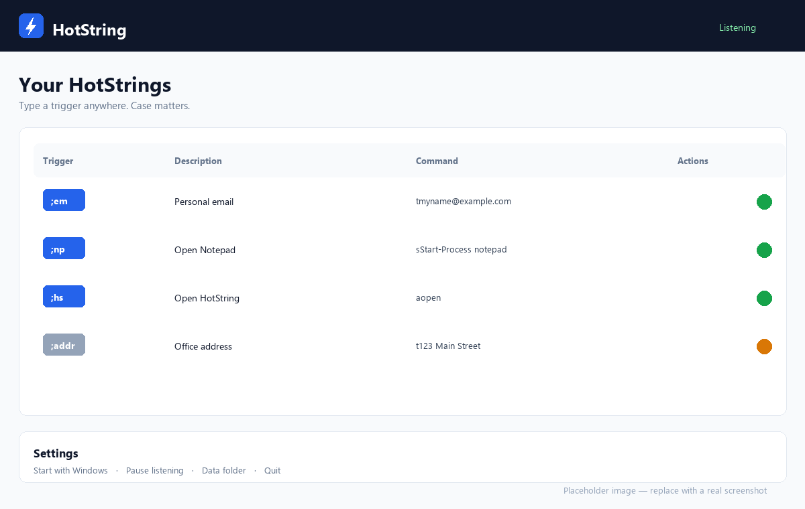
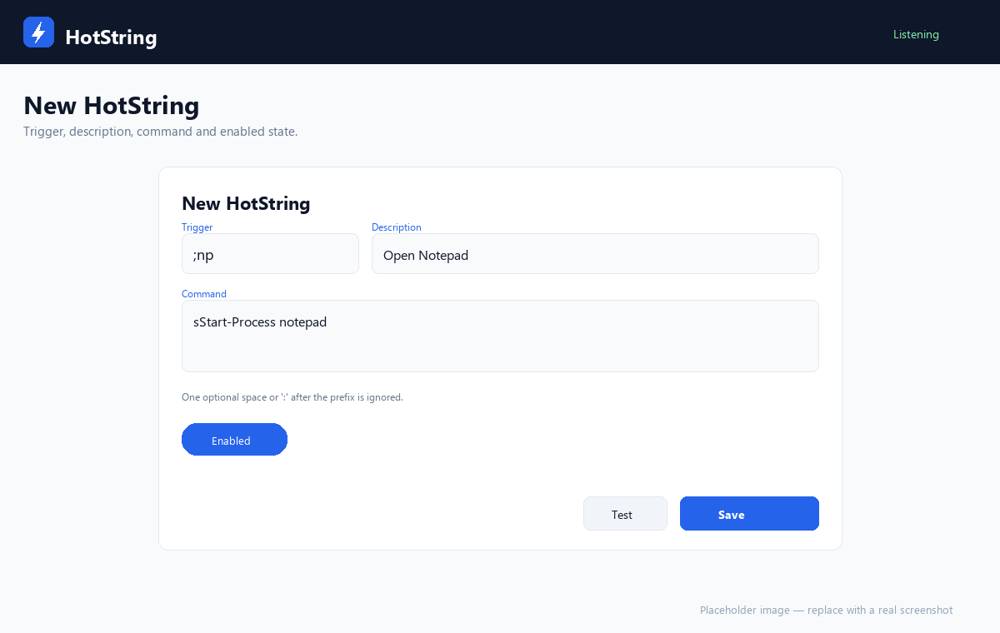
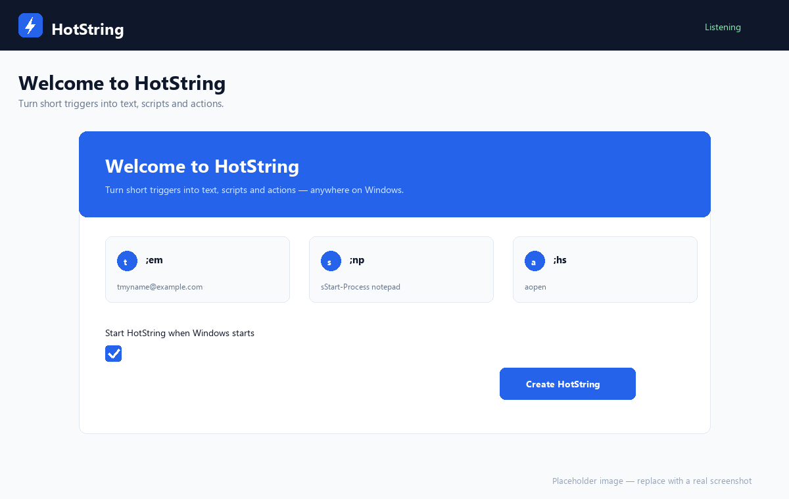

# HotString

[](https://github.com/jeeradate/hotstring2/actions/workflows/ci.yml)
[](LICENSE)
[](pyproject.toml)

**พิมพ์ให้น้อยลง ทำได้มากขึ้น (Type less. Do more.)**

HotString เป็นโปรแกรมอรรถประโยชน์สำหรับเดสก์ท็อป Windows ที่เปลี่ยนคำย่อสั้นๆ (รองรับตัวพิมพ์เล็ก-ใหญ่ต่างกัน) ให้กลายเป็นข้อความ, สคริปต์ PowerShell หรือคำสั่งจัดการตัวแอปเอง เพียงพิมพ์ Trigger ในโปรแกรม **ใดก็ได้** HotString จะลบคำย่อนั้นออกแล้วรันคำสั่งที่ตั้งค่าไว้ทันที

ตัวโปรแกรมทำงานอยู่เบื้องหลังใน System Tray อย่างเงียบเชียบ รองรับภาษาไทยและอักขระ Unicode อื่นๆ และมีหน้าต่างจัดการแบบ Native Desktop ที่สร้างด้วย NiceGUI และ pywebview

- **ขยายข้อความ (Text expansion)** — `;em` → `tmyname@example.com`
- **ตัวเรียกใช้ PowerShell (PowerShell launcher)** — `;np` → `sStart-Process notepad`
- **คำสั่งจัดการแอป (App actions)** — `;hs` → `aopen` (เรียกเปิดหน้าต่าง HotString จากที่ไหนก็ได้)
- **หน้าต่าง Native + ไอคอนใน Tray** — ไม่ต้องเปิดแท็บเบราว์เซอร์ ไม่มีหน้าต่างเกะกะตลอดเวลา
- **เก็บข้อมูลในเครื่อง (Local-first)** — ฐานข้อมูล SQLite อยู่ที่ `%APPDATA%\HotString` ไม่ต้องสมัครบัญชีหรือพึ่งพาบริการ Cloud

---

## ภาพหน้าจอ (Screenshots)

> รูปภาพด้านล่างเป็นภาพจำลอง (Placeholder) ที่เก็บไว้ใน `docs/screenshots/` กรุณาเปลี่ยนเป็นภาพหน้าจอจริงก่อนเผยแพร่รุ่นใช้งานจริง (Release)

| หน้าแดชบอร์ด (Dashboard) | หน้าแก้ไข (Editor) |
| --- | --- |
|  |  |

| หน้าจอต้อนรับเมื่อเปิดใช้งานครั้งแรก (First-run onboarding) |
| --- |
|  |

---

## ความต้องการของระบบ (Requirements)

- **Windows 10 หรือ Windows 11** (แพลตฟอร์มเป้าหมายหลัก; การ Import โค้ดเพื่อพัฒนาอาจทำบนระบบอื่นได้ แต่ระบบดักจับคีย์บอร์ดและการเปิดอัตโนมัติทำงานเฉพาะบน Windows เท่านั้น)
- **Python 3.11 หรือใหม่กว่า**
- **[uv](https://docs.astral.sh/uv/)** สำหรับการติดตั้งและรันโปรแกรม
- **Microsoft Edge WebView2 Runtime** สำหรับแสดงหน้าต่าง Native (ติดตั้งมาพร้อมกับ Windows 10/11 รุ่นปัจจุบันอยู่แล้ว; สามารถ[ดาวน์โหลดได้ที่นี่](https://developer.microsoft.com/microsoft-edge/webview2/)หากจำเป็น)
- **PowerShell** สำหรับคำสั่งหมวด `s` — HotString จะเลือกใช้ **PowerShell 7+ (`pwsh`)** เป็นอันดับแรกหากมีในเครื่อง และจะสลับไปใช้ **Windows PowerShell 5.1 (`powershell.exe`)** ที่ติดมากับ Windows แทนหากไม่มี

---

## การติดตั้งจาก Source Code

```powershell
git clone https://github.com/jeeradate/hotstring2.git
cd hotstring2
uv sync
uv run hotstring
```

การเปิดใช้งานครั้งแรกจะสร้างไฟล์ `%APPDATA%\HotString\hotstring.db` และแสดงหน้าจอต้อนรับ (Welcome Screen) เมื่อตั้งค่าเริ่มต้นเสร็จสิ้นเพียงครั้งเดียว ในการเปิดครั้งถัดๆ ไป HotString จะเริ่มทำงานใน System Tray โดยอัตโนมัติ

> Repository นี้กำหนดเวอร์ชัน Python 3.11 ไว้ในไฟล์ `.python-version` โดย `uv sync` จะดาวน์โหลดตัวแปลภาษา (Interpreter) รุ่นดังกล่าวให้โดยอัตโนมัติหากยังไม่ได้ติดตั้งในเครื่อง

สำหรับการรันชุดทดสอบ (Test suite):

```powershell
uv run pytest

```

---

## การใช้งานครั้งแรก (First run)

HotString จะถือว่าฐานข้อมูลเป็น "ฐานข้อมูลใหม่" เมื่อยังไม่มีคำสั่ง `aopen` อยู่ในระบบ โดยในการรันครั้งแรกโปรแกรมจะแสดงหน้าจอ Onboarding ซึ่งจะ:

1. อธิบายรูปแบบของ Trigger และ Command พร้อมตัวอย่างที่ใช้งานได้จริง
2. ตั้งค่าเริ่มต้น `;hs` → `aopen` ไว้ให้ล่วงหน้า
3. มีตัวเลือก **Start HotString when Windows starts (เปิด HotString อัตโนมัติเมื่อเริ่ม Windows)** ซึ่งถูกติ๊กเลือกไว้เป็นค่าเริ่มต้น

รายการ `aopen` มีความสำคัญมาก เพราะเป็นทางลัดฉุกเฉินสำหรับเรียกหน้าต่างจัดการให้กลับมาแสดงเมื่อถูกซ่อนไว้ หากฐานข้อมูลมีข้อมูลอยู่แล้วแต่ไม่มี `aopen` หน้าจอ Onboarding จะเสนอให้เพิ่มรายการนี้โดยไม่กระทบกับข้อมูลเดิมของคุณ

---

## การใช้งานประจำวัน (Everyday use)

* พิมพ์ Trigger ใน Notepad, เบราว์เซอร์, Slack, Word หรือแอปอื่นๆ HotString จะลบคำ Trigger นั้นออกแล้วรันคำสั่งทันที
* **ปิดหน้าต่าง** จัดการด้วยการกดปุ่ม X — HotString จะยังคงทำงานอยู่เบื้องหลังใน System Tray
* **เปิดหน้าต่างกลับมาใหม่** ได้จากไอคอนใน Tray หรือพิมพ์ Trigger ของ `aopen` (เช่น `;hs`)
* **การสั่งเปิดโปรแกรมซ้ำ (`uv run hotstring`)** — โปรแกรมตัวใหม่จะส่งสัญญาณบอกตัวที่รันอยู่เดิมให้แสดงหน้าต่างขึ้นมาแล้วปิดตัวเองลง เพื่อให้มีผู้ถือสิทธิ์ฐานข้อมูลเพียงตัวเดียวในแต่ละครั้ง
* **หยุดการทำงานชั่วคราว (Pause)** ได้จากเมนูใน Tray หรือหน้า Settings เมื่อคุณไม่ต้องการให้ Trigger ทำงาน
* **ออกจากโปรแกรม (Exit)** ได้จากเมนูใน Tray หรือในการ์ด Settings

### เมนูใน Tray (Tray menu)

| รายการ | หน้าที่การทำงาน |
| --- | --- |
| Open HotString | แสดงและดึงโฟกัสมาที่หน้าต่างจัดการ |
| Pause listening / Resume listening | หยุดหรือเริ่มการตรวจจับ Trigger ใหม่โดยไม่ต้องปิดโปรแกรม |
| Start with Windows | เปิด/ปิดการตั้งค่าให้โปรแกรมเริ่มทำงานพร้อม Windows สำหรับผู้ใช้ปัจจุบัน |
| Exit | หยุดตัวดักจับคีย์บอร์ด, ไอคอน Tray, ฐานข้อมูล และปิดโปรเซสทั้งหมด |

---

## รูปแบบคำสั่ง (Command format)

ทุกคำสั่งจะขึ้นต้นด้วย **อักษรระบุประเภท 1 ตัวอักษร** ส่วน Trigger จะมีความยาว **2–8 ตัวอักษร** และห้ามมีช่องว่าง

| ตัวนำหน้า (Prefix) | ประเภท | ตัวอย่าง | ผลลัพธ์ |
| --- | --- | --- | --- |
| `t` | ข้อความ (Text) | `tmyname@example.com` | พิมพ์ที่อยู่อีเมลออกมา |
| `s` | PowerShell | `sStart-Process notepad` | รันสคริปต์ด้วย Windows PowerShell |
| `a` | คำสั่งจัดการแอป (App action) | `aopen` | เปิดหน้าต่างโปรแกรม HotString |

เนื่องจาก HotString สามารถสั่งงาน PowerShell ได้ มันจึงสามารถสั่งงาน Windows ให้ทำงานแบบอัตโนมัติได้อย่างไม่มีที่สิ้นสุด คุณสามารถค้นหาคำสั่งของ PowerShell ในการทำเรื่องต่างๆ ทาง AI Chat เช่น Gemini, ChatGPT ฯลฯ แล้วคัดลอกมาทดสอบในช่อง Command ได้เลย

ตัวคั่น (Separator) 1 ตัวที่ตามหลัง Prefix ทันทีจะถูกข้ามไป (ไม่นำมาพิมพ์) ดังนั้นรูปแบบต่อไปนี้จึงให้ผลลัพธ์เหมือนกัน:

```text
tHello
t Hello
t:Hello

```

ระบบจะตัดตัวคั่นตัวแรกออกเท่านั้น ดังนั้น `t: Hello` จะพิมพ์ออกมาเป็น ` Hello` (มีช่องว่างนำหน้า 1 เคาะ) หลังจากตัว `t` ทุกอย่างจะถูกนำไปพิมพ์ตามตัวอักษรจริง รวมถึงเครื่องหมายโคลอน ช่องว่าง และการขึ้นบรรทัดใหม่

### คำสั่งข้อความ (`t`)

```text
tHello, world!
tmyname@example.com
tสวัสดีครับ

```

ช่องแก้ไขเป็นแบบ Textarea จึงรองรับข้อความหลายบรรทัด:

```text
tLine one
Line two
Line three

```

วิธีการส่งข้อความออกสู่หน้าจอ:

* ข้อความ ASCII สั้นๆ จะถูกส่งด้วยการจำลองการกดปุ่ม Unicode `SendInput` โดยไม่ยุ่งเกี่ยวกับ Clipboard
* ข้อความที่ไม่ใช่ ASCII (รวมถึงภาษาไทย), ข้อความหลายบรรทัด, แท็บ และข้อความยาวๆ จะใช้วิธีผ่าน Clipboard: บันทึกข้อความเดิมใน Clipboard ไว้ → คัดลอกข้อความใหม่ลงไป → กดวาง `Ctrl+V` → คืนค่าข้อความเดิมกลับเข้า Clipboard หลังจากหน่วงเวลาสั้นๆ
* สามารถกำหนดค่า `HOTSTRING_TEXT_MODE=type` หรือ `HOTSTRING_TEXT_MODE=paste` เพื่อบังคับใช้วิธีใดวิธีหนึ่งได้

### คำสั่ง PowerShell (`s`)

```text
sStart-Process notepad
sGet-Date | Set-Clipboard
sStart-Process "[https://github.com](https://github.com)"

```

สคริปต์จะถูกรันใน Background Thread ด้วยรูปแบบคำสั่ง:

```text
<powershell> -NoProfile -WindowStyle Hidden -ExecutionPolicy Bypass -Command <script>

```

`<powershell>` จะใช้ `pwsh` (PowerShell 7+) หากพบใน `PATH` มิฉะนั้นจะใช้ `powershell.exe` (Windows PowerShell) สามารถตรวจสอบไฟล์โปรแกรมที่ถูกเลือกใช้งานจริงได้ในหน้า **Settings** ของแอป

จะไม่มีหน้าต่าง Console เด้งขึ้นมาให้รบกวน โดยค่า Standard output, Standard error และ Exit code จะถูกบันทึกลงในไฟล์ Log หากคำสั่งจบด้วย Exit code ที่ไม่ใช่ 0 หรือเริ่มทำงานล้มเหลว ระบบจะแสดงการแจ้งเตือน (Notification) ให้ทราบ

เนื่องจาก HotString สามารถรันสคริปต์ PowerShell ได้ ความเป็นไปได้ในการสั่งงาน Windows อัตโนมัติจึงไร้ขีดจำกัด เพียงถาม AI อย่าง Gemini หรือ ChatGPT เพื่อขอคำสั่ง PowerShell สำหรับงานที่ต้องการ คัดลอก แล้วนำมาทดสอบใน HotString ได้ทันที!

> **คำเตือนด้านความปลอดภัย:** คำสั่ง `s` คือสคริปต์ PowerShell ที่รันด้วย **สิทธิ์ผู้ใช้งานของคุณ (User permissions)** โดยไม่มีระบบ Sandbox ครอบไว้ และมีการใช้ `-ExecutionPolicy Bypass` เพื่อให้สคริปต์ทำงานได้โดยไม่ต้องแก้ Policy ของเครื่อง กรุณาเพิ่มเฉพาะสคริปต์ที่คุณเขียนเองหรือเข้าใจการทำงานอย่างถ่องแท้ และตรวจสอบฐานข้อมูลที่ได้รับมาจากผู้อื่นก่อนรันเสมอ

### คำสั่งจัดการแอป (`a`)

| คำสั่ง | คำอธิบาย |
| --- | --- |
| `aopen` | แสดงหน้าต่างจัดการ HotString |
| `apause` | หยุดการตรวจจับชั่วคราว (Pause) |
| `aresume` | กลับมาตรวจจับต่อ (Resume) |
| `atoggle` | สลับสถานะเปิด/ปิดการตรวจจับ |
| `aexit` | ปิดโปรแกรม HotString |

คำสั่งที่ไม่รู้จักจะถูกปฏิเสธเมื่อกดบันทึก หากในฐานข้อมูลมีคำสั่งที่ไม่รู้จัก (เช่น เกิดจากการดาวน์เกรดเวอร์ชัน) คำสั่งนั้นจะถูกบันทึกลง Log และข้ามการทำงานไป

### กฎของ Trigger

* **ความยาว 2–8 ตัวอักษร** ห้ามมีช่องว่าง (Space), แท็บ หรืออักขระควบคุม (Control characters)
* **แยกตัวพิมพ์เล็ก-ใหญ่ (Case-sensitive):** `em` และ `EM` ถือเป็นคนละ Trigger กัน
* การจับคู่จะอ้างอิงตามตัวอักษรที่ภาษาแป้นพิมพ์ปัจจุบันพิมพ์ออกมา แป้นพิมพ์ไทยจะได้ตัวอักษรไทย แป้นพิมพ์อังกฤษจะได้ตัวอักษรอังกฤษ กรุณาสลับภาษาหรือเลือกใช้ตัวอักษรที่มีอยู่ในแป้นพิมพ์ที่คุณใช้งานอยู่
* ระบบจะค้นหาคำลงท้ายที่ตรงกันและ **ยาวที่สุด (Longest matching suffix)** เมื่อมีหลาย Trigger สิ้นสุดที่ตำแหน่งเดียวกัน
* สามารถตั้ง Trigger ที่เป็นส่วนขยายต่อท้ายกันได้ แต่ UI จะแจ้งเตือนให้ทราบ เช่น หากเปิดใช้งานทั้ง `;em` และ `em` เมื่อพิมพ์ `;em` ตัว `em` จะทำงานก่อน ทำให้ `;em` ไม่สามารถถูกเรียกใช้งานได้จริง
* ระบบจะเฝ้าดูเฉพาะ HotString ที่เปิดใช้งาน (Enabled) อยู่เท่านั้น และการเปลี่ยนแปลงจะมีผลทันที
* คำแนะนำสำหรับ HotString Trigger: อักษร `;` เป็น Prefix ที่เหมาะสม เพราะตัวอักษรที่ขึ้นต้นด้วยเซมิโคลอนแทบไม่มีในคำศัพท์ปกติ ช่วยป้องกันการพิมพ์ไปโดนโดยไม่ตั้งใจ

### สิ่งที่ล้างค่า Buffer ของ Trigger ที่รออยู่

หน่วยความจำชั่วคราวแบบเลื่อน (Rolling buffer) ขนาด 8 ตัวอักษรจะถูกล้างค่าเมื่อเกิดเหตุการณ์ต่อไปนี้:

* กดปุ่ม `Enter`, `Esc`, `Tab`, `space`
* กดปุ่มลูกศร (Arrow keys), `Home`, `End`, `Page Up`, `Page Down`, `Delete`, `Insert`
* กดปุ่มฟังก์ชัน `F1`–`F12`
* คลิกเมาส์หรือเลื่อนล้อเมาส์ (Scrolling)
* สลับหน้าต่างโปรแกรมที่ใช้งานอยู่ (Foreground window)
* การกด `Backspace` จะลบตัวอักษรล่าสุดออกจาก Buffer 1 ตัว
* การพิมพ์ขณะที่กด `Ctrl`, `Alt` หรือ `Win` ค้างไว้จะถูกข้ามไป

นอกจากนี้ HotString ยังข้ามการดักจับปุ่มที่ตัวมันเองเป็นคนสั่งพิมพ์ เพื่อป้องกันไม่ให้การขยายข้อความไปกระตุ้น Trigger ซ้ำซ้อน

---

## การจัดการ HotStrings (Managing HotStrings)

ตารางบนหน้าแดชบอร์ดจะแสดงรายการทั้งหมดพร้อม Trigger, คำอธิบาย (Description), คำสั่ง (Command) และสถานะเปิด/ปิด

* **เพิ่ม (Add)** — กดปุ่ม Add เพื่อเปิดหน้าต่างแก้ไข
* **แก้ไข (Edit)** — กดปุ่มรูปดินสอเพื่อเปิดหน้าต่างแก้ไขพร้อมข้อมูลปัจจุบัน
* **เปิด / ปิดใช้งาน (Enable / disable)** — ปุ่มสวิตช์ในตารางมีผลทันที รายการที่ปิดใช้งานจะยังคงอยู่ในฐานข้อมูลแต่จะไม่ถูกตรวจจับ
* **ลบ (Delete)** — ปุ่มรูปถังขยะจะถามยืนยันก่อนลบเสมอ
* **ค้นหา (Search)** — ช่องค้นหาสามารถกรองข้อมูลจาก Trigger, คำอธิบาย หรือคำสั่งได้
* **คำสั่งยาว (Long commands)** — หน้าต่างแก้ไขจะเลื่อนเฉพาะส่วนฟอร์ม โดยปุ่ม **บันทึก (Save)** และ **ทดสอบ (Test)** จะอยู่ด้านล่างตลอดเวลา ช่องคำสั่งจะหยุดขยายที่ความสูงประมาณหนึ่งในสามของหน้าต่างและเลื่อนภายในช่องเอง และปุ่ม **ขยาย (expand)** ที่มุมขวาบนของหน้าต่างแก้ไขจะขยายหน้าต่างให้เกือบเต็มจอ
* **ทดสอบ (Test)** — ปุ่ม Test ในหน้าแก้ไขจะแสดงตัวอย่างข้อความของคำสั่ง `t` แทนการพิมพ์จริง, สั่งรันสคริปต์ `s` แล้วแสดงผลลัพธ์ (Output) และตรวจสอบความถูกต้องของคำสั่ง `a` โดยยังไม่สั่งทำงานจริง
* **การตรวจสอบความถูกต้อง (Validation)** — Trigger ต้องไม่ซ้ำกัน มีความยาว 2–8 ตัวอักษร และไม่มีช่องว่าง หน้าแก้ไขจะแจ้งเตือนหาก Trigger ใหม่ไปซ้ำซ้อนเป็นคำลงท้ายของ Trigger อื่น (หรือในทางกลับกัน)

การเปลี่ยนแปลงทั้งหมดจะถูกบันทึกลง SQLite และอัปเดตไปยังตัวดักจับคีย์บอร์ดที่ทำงานอยู่ทันที จึงไม่จำเป็นต้องรีสตาร์ท HotString หลังการแก้ไข

---

## การตั้งค่า (Settings)

### เริ่มทำงานพร้อม Windows (Start with Windows)

การเปิดสวิตช์นี้จะเขียนค่าลงใน Registry Key ของ **ผู้ใช้ปัจจุบัน (Current user)**:

```text
HKCU\Software\Microsoft\Windows\CurrentVersion\Run
Value name: HotString
Value: "<pythonw.exe>" -m hotstring

```

ระบบจะเลือกใช้ `pythonw.exe` หากมี เพื่อไม่ให้มีหน้าต่าง Console ปรากฏขึ้นตอนเข้าสู่ระบบ การปิดสวิตช์จะลบเฉพาะค่าของ `HotString` ออกโดยไม่กระทบกับโปรแกรมเริ่มต้นอื่นๆ หากคุณมีการย้ายโฟลเดอร์ Virtual Environment ให้รัน `uv run hotstring` หนึ่งครั้ง หรือกดปิดแล้วเปิดสวิตช์นี้ใหม่เพื่ออัปเดต Path ที่บันทึกไว้

### หยุดการตรวจจับชั่วคราว (Pause listening)

การสั่ง Pause จะยังคงเปิดไอคอนใน Tray หน้าต่าง และฐานข้อมูลไว้ตามปกติ แต่จะหยุดการจับคู่ Trigger สถานะนี้จะแสดงให้เห็นที่แถบด้านบน (Header) และในเมนูของ Tray ทั้งนี้สถานะ Pause จะถูกรีเซ็ตกลับเป็นปกติเมื่อรีสตาร์ทโปรแกรม

### ข้อมูลและไฟล์บันทึก (Data and logs)

| รายการ | ตำแหน่งที่เก็บ |
| --- | --- |
| ฐานข้อมูล (Database) | `%APPDATA%\HotString\hotstring.db` |
| ไฟล์ Log แบบหมุนเวียน (Rotating log) | `%APPDATA%\HotString\hotstring.log` (ขนาด 1 MB × เก็บสำรอง 3 ไฟล์) |
| กำหนดโฟลเดอร์เก็บข้อมูลเอง | ตั้งค่าตัวแปร `HOTSTRING_DATA_DIR` ก่อนเปิดโปรแกรม |

การ์ด Settings จะแสดงตำแหน่ง Path ที่แท้จริงและมีปุ่ม **Open data folder** ให้กดเปิดได้ทันที ตัวฐานข้อมูลใช้โหมด SQLite WAL ซึ่งสามารถสำรองข้อมูล (Backup) ได้อย่างปลอดภัยด้วยการคัดลอกไฟล์ `hotstring.db` (รวมถึงไฟล์ `-wal`/`-shm` หากคัดลอกขณะที่ HotString กำลังทำงานอยู่ หรือคัดลอกหลังจากปิดโปรแกรมแล้ว)

---

## การพัฒนา (Development)

### โครงสร้างโปรเจกต์ (Project layout)

```text
hotstring/
├── src/hotstring/
│   ├── __init__.py          # เวอร์ชันของแพ็กเกจ
│   ├── __main__.py          # จุดเริ่มต้นการทำงาน (console-script / python -m)
│   ├── app.py               # วงจรชีวิตแอป, CLI, single instance และการเชื่อมต่อส่วนต่างๆ
│   ├── autostart.py         # การจัดการ Registry HKCU Run
│   ├── config.py            # การจัดการ Path, ค่าคงที่ และระบบ Log
│   ├── db.py                # SQLModel engine และคำสั่ง CRUD
│   ├── executor.py          # การแยกวิเคราะห์คำสั่ง, การพิมพ์, PowerShell และ Actions
│   ├── listener.py          # ตัวดักจับคีย์บอร์ดและเมาส์ระดับ Global ด้วย pynput
│   ├── matching.py          # ลอจิกการจับคู่คำใน Rolling buffer (แยกทดสอบได้อิสระ)
│   ├── models.py            # ตารางฐานข้อมูล SQLModel และการตรวจสอบข้อมูล
│   ├── native_window.py     # การดักจับปุ่มปิดหน้าต่าง pywebview เพื่อซ่อนลง Tray
│   ├── single_instance.py   # ระบบ Named mutex และ Event สำหรับเรียกแสดง UI
│   ├── tray.py              # ไอคอนและเมนูใน System Tray ด้วย pystray
│   └── ui.py                # หน้าแดชบอร์ด NiceGUI, Onboarding และ Dialogs
├── tests/
│   ├── test_models.py
│   ├── test_matching.py
│   └── test_executor.py
├── docs/screenshots/        # ภาพจำลองสำหรับ README
├── pyproject.toml
├── uv.lock
└── README.md

```

ส่วนดักจับคีย์บอร์ดและส่วนติดต่อผู้ใช้ (UI) ถูกแยกออกจากลอจิกหลักอย่างชัดเจน ทำให้ `matching.py`, การแยกวิเคราะห์คำสั่ง, การตรวจสอบความถูกต้อง และระบบฐานข้อมูล CRUD สามารถรันทดสอบได้ทั้งหมดโดยไม่ต้องติดตั้ง Keyboard Hook หรือเปิดหน้าต่างโปรแกรม

### คำสั่งที่มีประโยชน์

```powershell
uv sync                 # ติดตั้ง Dependencies
uv run pytest           # รันชุดทดสอบทั้งหมด
uv run pytest -q        # รันชุดทดสอบแบบแสดงผลย่อ
uv run hotstring --help # ดูตัวเลือกคำสั่ง CLI

```

### Debug flags

| Flag | วัตถุประสงค์ |
| --- | --- |
| `--show` | แสดงหน้าต่างจัดการทันทีที่เปิดโปรแกรม แม้ในกรณีปกติที่ไม่จำเป็นต้องแสดง |
| `--no-native` | เปิดหน้า UI ในเว็บเบราว์เซอร์แทนหน้าต่าง Native |
| `--no-tray` | ปิดการใช้งานไอคอนใน System Tray (ใช้คู่กับ `--no-hook` เวลาพัฒนา UI) |
| `--no-hook` | ปิดการใช้งานตัวดักจับคีย์บอร์ดระดับ Global |
| `--port PORT` | กำหนดหมายเลขพอร์ต HTTP ในเครื่องแบบเจาะจง |
| `--log-level LEVEL` | ระดับการเก็บ Log: `DEBUG`, `INFO`, `WARNING`, `ERROR` หรือ `CRITICAL` |
| `--version` | แสดงหมายเลขเวอร์ชันแล้วออกจากโปรแกรม |

สำหรับการทดลองปรับแต่ง UI แบบแยกส่วน (ไม่กระทบข้อมูลจริง):

```powershell
$env:HOTSTRING_DATA_DIR = "$env:TEMP\hotstring-dev"
uv run hotstring --show --no-tray --no-hook

```

### ตัวแปรสภาพแวดล้อม (Environment variables)

| ตัวแปร | ผลการทำงาน |
| --- | --- |
| `HOTSTRING_DATA_DIR` | ใช้แทนที่ `%APPDATA%\HotString` สำหรับเก็บฐานข้อมูล, Log และค้นหาไฟล์ Assets |
| `HOTSTRING_LOG_LEVEL` | ระดับ Log เริ่มต้นก่อนที่จะถูกแทนที่ด้วย CLI flag |
| `HOTSTRING_TEXT_MODE` | `auto` (ค่าเริ่มต้น), `type` หรือ `paste` |

### การทดสอบ (Tests)

```text
uv run pytest

```

ชุดทดสอบครอบคลุมตั้งแต่การตรวจสอบความถูกต้องของ Trigger, คำเตือนเรื่องคำลงท้ายซ้ำซ้อน, ระบบฐานข้อมูล CRUD และการตรวจจับการรันครั้งแรก, การจับคู่ใน Rolling buffer, การแยกวิเคราะห์คำสั่ง, การเลือกวิธีส่งข้อความ, การสร้าง Argument ของ PowerShell, การเรียกใช้ Action และการรายงานข้อผิดพลาดแบบ Asynchronous โดยคำสั่ง PowerShell และการพิมพ์ข้อความจะถูกจำลองขึ้น (Mocked) ดังนั้นการรันทดสอบจะไม่พิมพ์ข้อความลงบนหน้าจอของคุณหรือรันสคริปต์จริง

---

## การแก้ไขปัญหาเบื้องต้น (Troubleshooting)

**พิมพ์ Trigger แล้วไม่มีอะไรเกิดขึ้น**

* ตรวจสอบว่าเปิดโหมด Pause อยู่หรือไม่ (ดูที่ป้ายสถานะด้านบนหรือเมนูใน Tray)
* Trigger แยกตัวพิมพ์เล็ก-ใหญ่ และขึ้นอยู่กับภาษาแป้นพิมพ์ที่กำลังใช้งานอยู่
* หน้าต่างโปรแกรมที่กำลังพิมพ์ต้องอยู่ในสถานะโฟกัส (Keyboard focus); HotString ไม่สามารถมองเห็นการพิมพ์ในโปรแกรมที่รันด้วยสิทธิ์ Administrator ("Run as administrator") ได้ เว้นแต่จะรัน HotString ด้วยสิทธิ์ Administrator เช่นกัน
* ตรวจสอบให้แน่ใจว่า HotString รายการนั้นถูกเปิดใช้งาน (Enabled) อยู่ และไม่ได้ติดปัญหาคำลงท้ายซ้ำซ้อนกับ Trigger ที่สั้นกว่า
* ตรวจสอบไฟล์ `%APPDATA%\HotString\hotstring.log` เพื่อดูข้อผิดพลาดของระบบดักจับคีย์บอร์ด (Hook errors)

**หน้าต่างโปรแกรมไม่ปรากฏขึ้น**

* คลิกที่ไอคอนใน Tray → **Open HotString** หรือพิมพ์ Trigger ของ `aopen`
* หากหน้าต่าง Native ไม่สามารถเปิดได้ HotString จะบันทึกข้อผิดพลาดลง Log และอาจแสดงหน้าต่างแจ้งเตือน ให้ลองติดตั้งหรือซ่อมแซม Edge WebView2 Runtime
* ลองรันคำสั่ง `uv run hotstring --show --no-tray --no-hook --log-level DEBUG` เพื่อแยกตรวจสอบสาเหตุของปัญหา

**คำสั่ง `s` ทำงานล้มเหลว**

* ตรวจสอบว่าโปรแกรม PowerShell ที่แสดงในหน้า **Settings** สามารถใช้งานได้จริง และสคริปต์นั้นรันผ่านเมื่อนำไปรันด้วยตัวเองใน Shell ดังกล่าว
* อ่านไฟล์ Log เพื่อดูข้อความ Standard output, Standard error และ Exit code
* คำสั่ง Cmdlets และพฤติกรรมบางอย่างอาจแตกต่างกันระหว่าง Windows PowerShell 5.1 และ PowerShell 7+ หากสคริปต์ต้องการเวอร์ชันใดเป็นพิเศษ ให้ติดตั้งเวอร์ชันนั้นและตรวจสอบในหน้า **Settings** ว่า HotString เลือกใช้ตัวที่ถูกต้อง

**ข้อมูลใน Clipboard ถูกเขียนทับชั่วคราว**

เป็นพฤติกรรมปกติสำหรับข้อความ Unicode, ข้อความหลายบรรทัด และข้อความขนาดยาว โดย HotString จะคืนค่า **ข้อความ** เดิมกลับเข้า Clipboard ให้หลังจากนั้นครู่เดียว ทั้งนี้รูปภาพและข้อมูลรูปแบบอื่นๆ ใน Clipboard จะไม่ถูกเก็บรักษาไว้และจะถูกแทนที่ด้วยข้อความ

**Start with Windows ไม่ทำงานหลังจากย้ายโฟลเดอร์โปรเจกต์**

ค่าใน Registry Run เก็บตำแหน่ง Path แบบเต็มของ `pythonw.exe` เอาไว้ ให้กดปิดแล้วเปิดสวิตช์ **Start with Windows** ใหม่จากสภาพแวดล้อมปัจจุบัน หรือเข้าไปแก้ไขค่า `HotString` ใน `HKCU\Software\Microsoft\Windows\CurrentVersion\Run`

**ดูเหมือนมีโปรแกรมรันซ้อนกัน 2 ตัว**

HotString ใช้ Named mutex แยกตาม Windows session การเปิดโปรแกรมครั้งที่สองจะส่งสัญญาณบอกตัวแรกให้แสดงหน้าต่างแล้วปิดตัวเองลง หากเกิดกรณีโปรเซสเดิมค้างจนสถานะผิดพลาด ให้ลอง Sign out แล้ว Sign in ใหม่ ระบบปฏิบัติการจะล้างค่า Kernel objects ที่ค้างอยู่เมื่อโปรเซสสิ้นสุดลง

---

## ข้อจำกัดที่ทราบ (Known limitations)

* **รองรับเฉพาะ Windows เท่านั้น** ระบบดักจับคีย์บอร์ด, `SendInput`, การตั้งค่าเปิดอัตโนมัติผ่าน Registry และการป้องกันการเปิดซ้อน ถูกพัฒนาขึ้นสำหรับ Windows โดยเฉพาะ
* **ไม่ใช่โปรแกรมดักจับรหัสผ่าน (Keylogger)** ตัวดักจับจะเก็บตัวอักษรในหน่วยความจำสูงสุดเพียง 8 ตัวอักษร และล้างทิ้งทันทีเมื่อเปลี่ยนหน้าต่าง กดปุ่มควบคุม หรือจับคู่คำสำเร็จ อย่างไรก็ตาม เนื่องจากเป็นการดักจับคีย์บอร์ดระดับ Global กรุณาตรวจสอบซอร์สโค้ดและนโยบายความเป็นส่วนตัวก่อนนำไปใช้งานในสภาพแวดล้อมขององค์กร
* **ข้อจำกัดด้านสิทธิ์ระดับสูง (Elevation boundary)** ระบบความปลอดภัยของ Windows บล็อกไม่ให้โปรเซสที่มีสิทธิ์ต่ำกว่าส่งคำสั่งพิมพ์เข้าไปยังหน้าต่างที่รันด้วยสิทธิ์สูงกว่า HotString จึงไม่สามารถขยายคำย่อในโปรแกรมที่รันแบบ Administrator ได้ เว้นแต่จะรัน HotString แบบ Administrator ด้วยเช่นกัน (ซึ่งไม่แนะนำเป็นค่าเริ่มต้น)
* **การคืนค่า Clipboard รองรับเฉพาะข้อความ** ข้อมูลที่ไม่ใช่ข้อความ เช่น รูปภาพ ไฟล์ หรือ Rich HTML จะถูกแทนที่เมื่อโปรแกรมใช้วิธีวางผ่าน Clipboard
* **ยังไม่มีระบบแยก Trigger ตามรายโปรแกรม, โฟลเดอร์, นำเข้า/ส่งออก หรือ Sync** ข้อมูล HotStrings ทั้งหมดจะรวมอยู่ในตารางเดียวภายในเครื่อง
* **ไม่มีประวัติการเลิกทำ (Undo history)** การลบ HotString จะเป็นการลบออกจากฐานข้อมูลอย่างถาวร
* **การจำลองการกดปุ่มจากโปรแกรมอัตโนมัติอื่น** อาจถูกมองว่าเป็นการพิมพ์ปกติ HotString จะข้ามเฉพาะการพิมพ์ที่เกิดจากตัวมันเองเท่านั้น โปรแกรมอัตโนมัติตัวอื่นอาจเผลอไปกระตุ้น Trigger ได้
* **ช่องกรอกรหัสผ่านและช่องรับข้อมูลปลอดภัย (Secure input)** HotString ไม่สามารถตรวจจับได้ว่าช่องกรอกข้อความนั้นเป็นช่องรหัสผ่าน Trigger จึงอาจทำงานในช่องเหล่านั้นเหมือนข้อความทั่วไป
* **ยังไม่มีตัวติดตั้ง (Installer) หรือการเซ็นรับรองโค้ด (Code signing)** โปรเจกต์นี้เผยแพร่ในรูปแบบ Source Code และรันผ่าน `uv`
* **การแจ้งเตือนผ่าน Tray ทำงานตามความพร้อมของระบบ** การรองรับของ `pystray` อาจแตกต่างกันไปตามการตั้งค่าของ Windows และการตั้งค่าการแจ้งเตือนในแต่ละเครื่อง
* **ทำงานแยกตาม Desktop session** ระบบ Mutex และ Event เรียกหน้าต่างจะถูกจำกัดขอบเขตอยู่ใน Session ของผู้ใช้ปัจจุบันเท่านั้น หากใช้ฟีเจอร์ Fast User Switching จะสามารถรันโปรแกรมแยกกันได้ Session ละ 1 ตัว

---

## สัญญาอนุญาต (License)

MIT ดูรายละเอียดเพิ่มเติมได้ที่ [LICENSE](https://www.google.com/search?q=LICENSE)

HotString เป็นโปรแกรมอรรถประโยชน์อิสระ และไม่มีส่วนเกี่ยวข้องใดๆ กับ Microsoft, NiceGUI หรือแอปพลิเคชันอื่นๆ ที่ตัวโปรแกรมเรียกใช้งาน

```

```